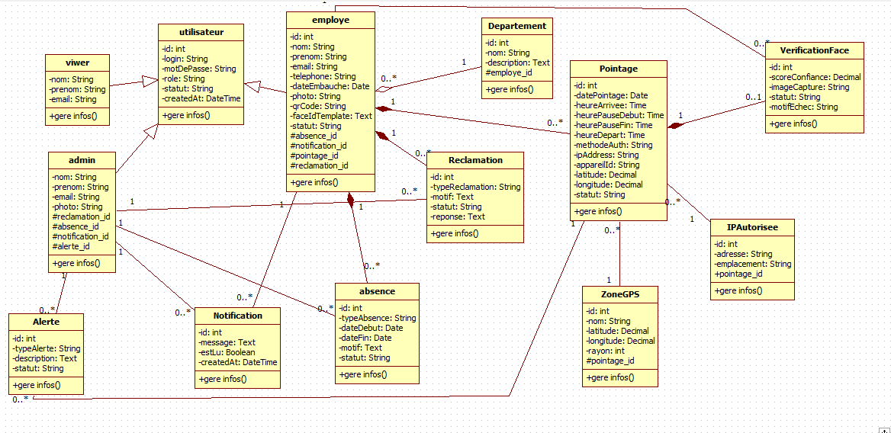

# ⏱️ GestiPoint

### Application web de gestion du pointage et des présences

**Présences • Pauses • Absences • Reconnaissance faciale • Suivi RH**


---

## 🎯 Présentation

GestiPoint est une application web permettant de centraliser le suivi des présences des employés et de remplacer les feuilles de pointage papier.

Elle permet d’enregistrer les arrivées, les départs et les pauses, de suivre les heures travaillées et de gérer les absences, les congés et les réclamations.

La plateforme propose des espaces adaptés aux administrateurs, aux managers/RH, aux employés et aux visiteurs en lecture seule. Elle comprend également des mécanismes de reconnaissance faciale et de contrôle GPS/IP.

## ✨ Fonctionnalités

| Domaine | Fonctionnalités |
| --- | --- |
| Pointage | Enregistrement des arrivées et des départs |
| Pauses | Suivi du début et de la fin des pauses |
| Temps de travail | Calcul des heures travaillées |
| Reconnaissance faciale | Interface de vérification du visage lors du pointage |
| Géolocalisation | Vérification des zones GPS autorisées |
| Contrôle IP | Gestion des adresses IP autorisées |
| Employés | Ajout, modification et gestion du personnel |
| Départements | Organisation des employés par département |
| Absences | Gestion des absences, congés et déplacements |
| Réclamations | Envoi et traitement des réclamations |
| Notifications | Consultation des notifications |
| Alertes | Suivi des pointages suspects |
| Historique | Consultation des pointages par période |
| Rapports | Statistiques et rapports de présence |
| Exports | Export compatible Excel et rapport imprimable en PDF |

> Le projet comprend également des endpoints de génération et de lecture de QR codes. Leur intégration doit être vérifiée dans l’environnement de développement.

## 👥 Rôles utilisateurs

| Rôle | Utilisation principale |
| --- | --- |
| Administrateur | Gestion du personnel, des pointages, des alertes et des paramètres |
| Manager / RH | Suivi des équipes, traitement des demandes et consultation des rapports |
| Employé | Pointage, consultation du profil, demandes et notifications |
| Viewer | Consultation des informations de suivi en lecture seule |

## 🛠️ Technologies utilisées

| Couche | Technologies |
| --- | --- |
| Backend | PHP, PDO et sessions |
| Base de données | MySQL |
| Frontend | HTML, CSS et JavaScript |
| Interface | Bootstrap 5 et Font Awesome |
| Reconnaissance faciale | face-api.js |
| Environnement local | XAMPP |

## 🖼️ Captures d’écran

### 1. Page d’accueil

Présentation de la plateforme, aperçu des fonctionnalités et accès à la connexion.

![!\[Accueil GestiPoint\]c:\xampp\htdocs\gestion_pointage\docs\WhatsApp Image 2026-10-13 at 16.55.31 (1).jpeg](<docs/WhatsApp Image 2026-10-13 at 16.55.31 (1).jpeg>)
### 2. Connexion

Interface de connexion avec identifiant et mot de passe.


### 3. Tableau de bord administrateur

Vue synthétique du personnel, des présences, des retards et des absences du jour.


### 4. Gestion du personnel

Liste des employés, informations professionnelles, départements et actions de gestion.


### 5. Espace employé

Accueil personnel avec accès direct au pointage.

### 6. Pointage

Interface affichant l’heure, le bouton d’arrivée avec reconnaissance faciale et l’état de la pause.

.jpeg>)

### 7. Enregistrement d’une absence

Formulaire permettant de sélectionner un employé, un type d’action, des dates, un motif et un statut.


### 8. Historique des pointages

Consultation des pointages par mois avec récapitulatif et détail des enregistrements.


### 9. Rapports et statistiques

Filtrage par période, indicateurs de présence et accès aux exports.


> Certaines captures présentent une période sans pointages et illustrent les états vides de l’application.

## 📐 Conception UML

### Diagramme de cas d’utilisation

Le diagramme présente les interactions des employés, de l’administration/RH et des visiteurs avec la plateforme.

Il décrit notamment le pointage, les pauses, la gestion du personnel, la consultation des rapports et les contrôles de visage, de localisation et d’adresse IP.

.jpeg>)

### Modèle de classes

Le fichier source du modèle est disponible ici :

Ce fichier utilise le format XML historique de StarUML. Il contient notamment les classes liées aux utilisateurs, aux employés, aux départements, aux pointages, aux absences, aux réclamations, aux notifications et aux contrôles de sécurité.

## 🚀 Installation locale

### 1. Préparer l’environnement

Installer XAMPP ou un environnement équivalent comprenant :

- Apache ;
- PHP avec l’extension `pdo_mysql` ;
- MySQL ;
- phpMyAdmin.

### 2. Installer le projet

Placer le dossier du projet dans :

```text
C:\xampp\htdocs\gestion_pointage
```

Démarrer **Apache** et **MySQL** depuis le panneau XAMPP.

### 3. Configurer la base de données

Créer une base nommée :

```text
gestion_pointage
```

Importer l’export SQL correspondant à la version du projet.

> L’archive utilisée pour cette documentation ne contient pas de fichier SQL. L’export de la base doit être récupéré depuis l’environnement de développement original. Une base vide ne suffit pas pour faire fonctionner les pages connectées.

### 4. Adapter la connexion

Configurer les paramètres dans `includes/config.php` :

```php
$host = 'localhost';
$dbname = 'gestion_pointage';
$username = 'root';
$password = '';
```

Ces paramètres sont un exemple pour le développement local.

> Le fichier fourni contient deux blocs de connexion PDO : vérifier les deux occurrences lors d’une modification.

### 5. Accéder à l’application

Ouvrir dans le navigateur :

```text
http://localhost/gestion_pointage/
```

Pour accéder directement à la connexion :

```text
http://localhost/gestion_pointage/login.php
```

### 6. Autoriser la caméra et la localisation

Autoriser l’accès à la caméra et à la géolocalisation dans le navigateur.

Pour une utilisation distante, servir l’application en HTTPS.

Le chemin local prévu pour les modèles de reconnaissance faciale est :

```text
assets/models/face-api/
```

Ce dossier n’est pas présent dans l’archive fournie. La page de pointage prévoit des sources distantes de secours ; vérifier leur accessibilité ou installer les modèles localement.

## 📂 Organisation du projet

| Chemin | Contenu |
| --- | --- |
| `admin/` | Administration et paramètres |
| `Manager/` | Espace manager et RH |
| `employe/` | Espace personnel et pointage |
| `viewer/` | Consultation |
| `api/` | Endpoints visage, GPS, QR code et notifications |
| `includes/` | Configuration, authentification et fonctions |
| `assets/css/` | Feuilles de style |
| `assets/js/` | Scripts JavaScript |
| `assets/images/captures/` | Captures faciales privées |
| `docs/screenshots/` | Captures utilisées dans le README |
| `docs/uml/` | Fichier source UML |
| `index.php` | Accueil |
| `login.php` | Connexion |
| `register.php` | Inscription |
| `logout.php` | Déconnexion |

## 🔎 Points techniques

- Le dossier fourni est nommé `Manager/`, alors que certains liens utilisent `manager/`. Harmoniser la casse avant un déploiement sous Linux.
- L’export Excel produit un fichier CSV compatible avec Excel.
- L’export PDF affiche une page imprimable : utiliser « Enregistrer en PDF » dans le navigateur.
- La reconnaissance faciale utilise face-api.js et doit être testée avec plusieurs utilisateurs.
- Les permissions effectives dépendent des contrôles PHP de chaque page.

## 🔐 Préparation à la mise en production

- Remplacer les comptes de démonstration codés en dur.
- Utiliser `password_hash()` et `password_verify()` pour les mots de passe.
- Externaliser les secrets et renforcer la validation côté serveur.
- Vérifier les autorisations, la protection CSRF et les données reçues.
- Exclure les captures faciales et les données personnelles du dépôt public.
- Protéger ou retirer les scripts utilitaires sensibles, notamment `reset_all.php`.

## 🧭 Améliorations possibles

- Ajouter un schéma SQL versionné et des données de démonstration anonymisées.
- Améliorer l’expérience mobile.
- Ajouter des tests sur les pointages, les pauses et les permissions.
- Renforcer la vérification faciale et la gestion des erreurs GPS.
- Automatiser les rapports périodiques.

---

**GestiPoint — Simplifier le suivi quotidien des présences.**
